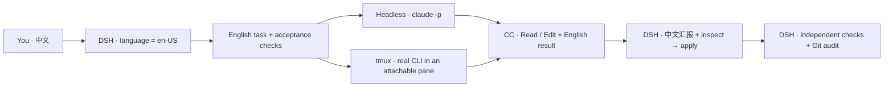
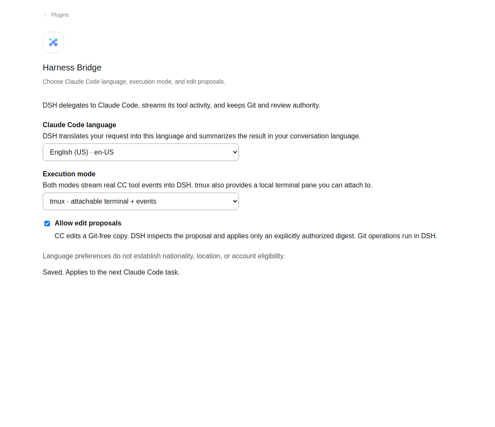
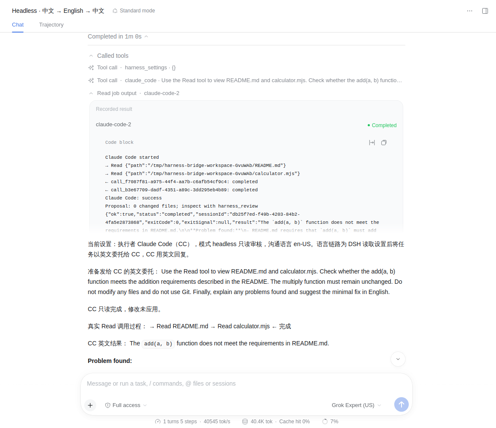
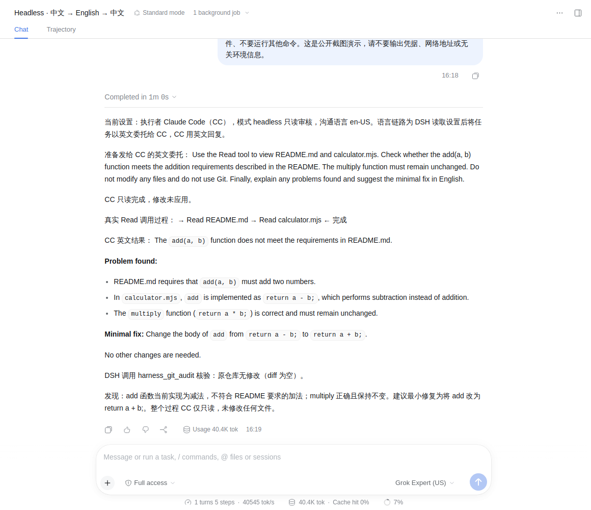
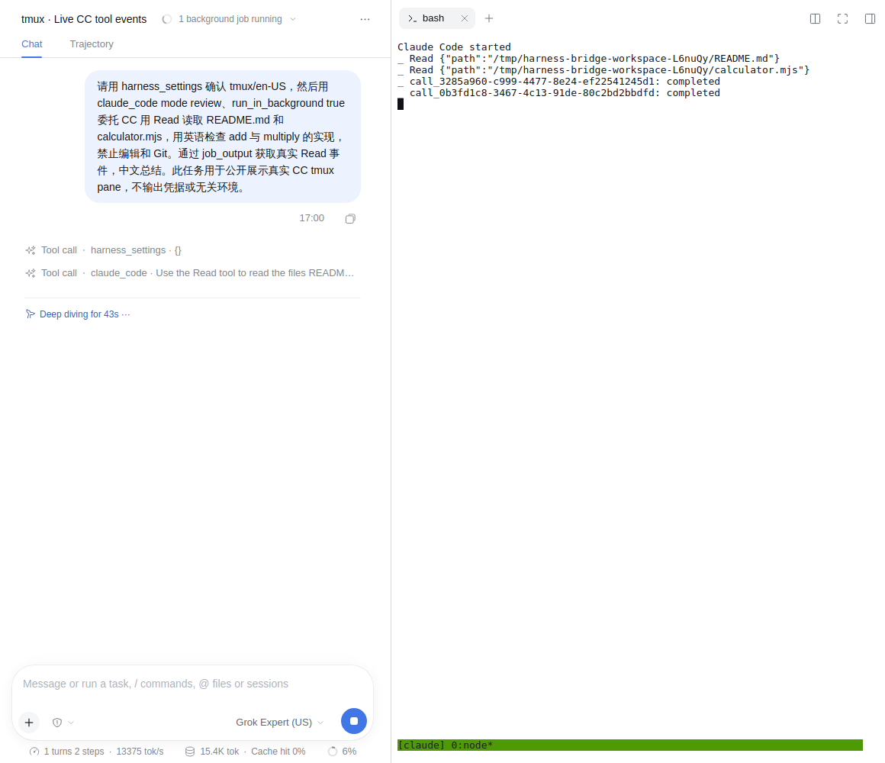
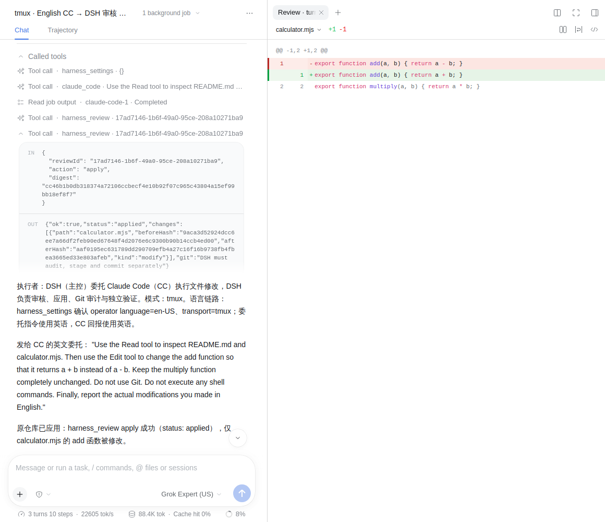
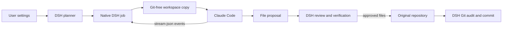

<div align="center">

**English** · [简体中文](docs/README.zh-CN.md)

# 🌉 Harness Bridge

### Plan in DeepSeek Harness. Watch Claude Code work. Review before applying.

**A local DSH plugin for your existing Claude Code CLI — headless or inside a managed tmux session.**


[](https://github.com/WaeoTech/harness-bridge/actions/workflows/ci.yml)


[](LICENSE)

[Quick start](#quick-start) · [Language and execution settings](#language-and-execution-settings) · [Live progress](#live-progress) · [Review and Git](#review-and-git) · [Validation](docs/validation.md) · [Grok setup](docs/grok-compat.md)

</div>

---

| DSH plans | Claude Code executes | DSH reviews |
| --- | --- | --- |
| Select the working language, scope the task and define acceptance checks. | Work in a Git-free copy using the installed CLI. Stream real tool events to a native DSH job. | Inspect the proposal, approve the exact digest, apply files and own every Git operation. |

## What it does

- **Two execution modes:** launch a bounded headless process or run that same real CLI inside an attachable, plugin-owned tmux pane.
- **Actual progress in DSH:** show tool names, paths, completion/failure events and final status from Claude's `stream-json` protocol.
- **Language in settings:** choose Simplified Chinese, US English, UK English or Japanese. The parent is instructed to compose tasks in that language; a worker system instruction sets the response language and writing style.
- **Proposals before writes:** Claude edits a temporary copy. The original project stays unchanged until DSH applies a reviewed proposal.
- **Git belongs to DSH:** omit `.git` from the worker, deny shell/subagents/MCP and guard file-tool access. DSH audits the original repository and decides whether to stage, commit or push.
- **Bounded lifecycle:** explicit UUID continuation, turn/budget/timeout limits, one active worker per instance and up to eight retained proposal copies.

**Version 0.2.0 is experimental.** Source is public; npm has not been published. Linux is the tested platform. The [validation record](docs/validation.md) separates local API tests, real CLI/Grok tests and remaining GUI/platform checks. No account-safety or benchmark claim is made.

## See the interaction

**Chinese request → English delegation → real CC tools → Chinese report → DSH review and Git.** Choose the worker language independently from your conversation language.



| Mode | Where Claude Code runs | What you can watch |
| --- | --- | --- |
| Headless | A managed background CLI process | Real tool events in DSH's native job output; English CC findings and a Chinese parent report |
| tmux | The same CLI protocol inside a private tmux pane | The native DSH job output **and** the actual pane attached from a terminal on the same host |

The following screenshots come from a real, isolated **US DSH Web instance** with Claude Code `2.1.325` using an operator-configured Grok proxy. They are not generated mockups. The bundle was loaded from a local symlink; the GUI's Add plugin installation dialog was not part of this check.

<details>
<summary><strong>1 · Plugins → Harness Bridge: choose language, mode and edit policy</strong></summary>

Select `English (US) · en-US`, choose headless or tmux, and enable edit proposals only when needed. The native form confirms a saved change; the next `harness_settings` call reads that value.



</details>

<details open>
<summary><strong>2 · Headless: DSH delegates in English and receives actual Read events</strong></summary>

A Chinese request asks CC to inspect the arithmetic module without changing it. DSH delegates in English, reads the native job's actual tool events and returns a Chinese explanation of the English findings. The original Git diff stays empty.





</details>

<details open>
<summary><strong>3 · tmux: watch the real Claude Code pane alongside DSH</strong></summary>

The CLI runs inside a plugin-owned tmux session. Attach from DSH's terminal, using the same host and OS user, to watch the same real CC process. The screenshot shows a read-only follow-up checking the repaired module; the edit run used actual `Read → Read → Edit` events.



</details>

<details>
<summary><strong>4 · DSH review: inspect the proposal, apply its digest and audit Git</strong></summary>

For the edit run, CC changed only `add` from subtraction to addition in its Git-free copy. DSH inspected the proposal, applied the exact digest under explicit authorization and fetched the original repository's real Git diff. CC did not execute Git. Independent checks verify both additions and the unchanged multiplication.



</details>

Language conversion is performed by the parent model under the task instructions, with a matching worker language preset. There is no separate translation service. Always inspect real tool results: a model's statement that it ran a command is not execution evidence. [Validation and limitations](docs/validation.md).

## Quick start

Install Node.js 22+, DSH `0.2.0-rc.2`, pnpm for DSH's plugin manager, and Claude Code with your own authentication. Install tmux separately if using that transport.

```bash
git clone https://github.com/WaeoTech/harness-bridge.git
cd harness-bridge
node bin/cli.js doctor
dsh plugin --profile web add "$PWD"
```

Configure the inserted `tool-harness-bridge` entry through the running DSH configuration editor, or add a complete override to the profile patch and apply it through DSH's supported configuration flow:

```yaml
- id: tool-harness-bridge
  config:
    workspaceRoot: /absolute/project
    executable: claude
    language: en-US
    transport: tmux
    allowEdits: false
    maxTurns: 8
    maxBudgetUsd: 2
    timeoutMs: 300000
```

An absolute `workspaceRoot` is required. The bridge does not guess the current workspace. One plugin instance serves one configured root. Changing a patch file alone does not guarantee that an existing DSH process reloads it.

Use an unrestricted (`danger-full-access`) DSH session:

> Read harness_settings. Ask Claude Code to review the authentication module in the configured language. Run it in the background, follow the job's real tool events, then verify the findings yourself. Stop on authentication or permission failures.

Set `allowEdits: true` in operator settings before delegating `mode: "edit"`. Worker output then includes a `reviewId`; edits still remain in the copy.

```bash
dsh plugin --profile web remove @waeotech/harness-bridge
```

## Language and execution settings

Open **Plugins → Harness Bridge** in DSH Web to choose the Claude Code language, execution mode and edit proposal policy. The form saves through DSH's native configuration service and reports whether the host accepted the change. Configure the project directory, executable and limits in the host's `tool-harness-bridge` configuration. Changes affect subsequent tasks; an active task keeps its captured language, limits and transport.

| Setting | Values / behavior |
| --- | --- |
| `language` | `zh-CN` (default), `en-US`, `en-GB`, `ja-JP` |
| `transport` | `headless` (default) or `tmux` |
| `workspaceRoot` | Absolute original project directory |
| `allowEdits` | Default `false`; permits worker edit proposals and reviewed apply |
| `executable` | Local `claude` or an operator-configured provider wrapper |
| `maxTurns` | 1–100; default 8 |
| `maxBudgetUsd` | Positive budget up to 100; default 2; reported costs remain estimates |
| `timeoutMs` | Up to one hour; default five minutes |

`harness_settings` exposes language, transport and edit policy to the parent before it composes a task. The plugin does not use a separate translation model. Language presets control communication and spelling; they do not establish nationality, location or account eligibility.

## Live progress

Both transports consume the real CLI's event stream. Native DSH job output contains readable lifecycle lines:

```text
Claude Code started
→ Read {"path":"src/calculator.js"}
← toolu_...: completed
→ Edit {"path":"src/calculator.js"}
← toolu_...: completed
Claude Code: success
Proposal: 1 changed files; inspect with harness_review
```

These lines describe observed events. They do not expose hidden reasoning, stream full file bodies or claim a check passed merely because the worker says so.

Set `run_in_background: true` in `claude_code` to return a `jobId` immediately, then use DSH `job_output` and `job_kill`. Foreground runs also create a native job and wait for its result.

With `transport: tmux`, the job emits an attach command while the worker is running:

```bash
tmux -S '/tmp/harness-bridge-tmux-.../socket' attach -t claude
```

The plugin creates a private tmux server, starts `claude -p` in its pane, displays real tool lifecycle lines there and forwards the raw structured events to DSH. Completing or cancelling the task removes that server and its temporary logs. Attaching requires terminal access to the same host and OS account. This mode does not take over a pre-existing manually opened Claude TUI, and tmux is not used to scrape terminal text or simulate keystrokes.

## Review and Git



1. **Prepare:** copy regular project files and directories into a temporary workspace. Exclude `.git`, `.claude`, `node_modules`, symlinks and special files.
2. **Execute:** allow `Read`, `Glob`, `Grep`; edit mode additionally allows `Edit` and `Write`. Load the bridge's own settings/hook, disable normal user/project setting sources and slash commands, supply an empty MCP configuration and deny Bash/subagents/MCP.
3. **Guard:** a `PreToolUse` hook rejects other tools, Git/Claude metadata paths, traversal and symlink access outside the copy.
4. **Inspect:** `harness_review {reviewId, action:"inspect"}` returns changes, a readable diff and a digest. DSH checks scope and acceptance evidence and obtains the user's authorization to apply.
5. **Apply:** `harness_review {reviewId, action:"apply", digest}` checks the frozen proposal and the entire original snapshot, then copies reviewed additions/modifications. Changes to either side refuse the apply. Failures attempt rollback. Deletions are currently rejected.
6. **Audit:** `harness_git_audit` reads original Git status and HEAD diff in DSH. DSH performs further tests and any staging, commit or push using its own tools and authorization.
7. **Discard or continue:** discard unused copies, or resume the exact returned `sessionId` while its review is retained. Resume requires the same root, subdirectory, mode, language and parent agent. Applied/discarded workers cannot be resumed.

Review records live only in the current plugin instance. Restart/disposal removes retained copies. Retained copies consume disk space; the ninth new worker is rejected until an earlier copy is applied or discarded. Limits are 64 MiB, 5,000 regular files and 10,000 entries per snapshot; diffs truncate explicitly at 4 MiB.

**The guard is not an OS sandbox.** Claude and DSH share an OS account; the CLI and any operator-selected executable are trusted. `danger-full-access` does not provide filesystem or credential isolation. File-tool checks, repeated path checks and `O_NOFOLLOW` cannot eliminate every concurrent parent-rename race. Use OS-level isolation for hostile executables or repositories. Applying is an optimistic file operation with rollback, not an atomic filesystem transaction.

## Tools and result semantics

| Tool | Responsibility |
| --- | --- |
| `harness_settings` | Read current communication language, transport and edit policy |
| `claude_code` | Launch or resume a bounded worker, foreground or background |
| `harness_review` | Inspect, apply an exact digest, or discard a retained proposal |
| `harness_git_audit` | DSH-side read-only Git status and diff of the original repository |

A successful worker with changes returns `status: "awaiting_review"`. Permission denials remain failures. `completed` means the CLI ended without a reported error; independent tests establish whether its answer is correct. The bridge does not automatically stage, commit, push, retry authentication or swap providers.

The exported core and standalone `bin/cli.js run` are low-level debugging interfaces. They do not provide the native plugin's copy/review workflow, settings form, jobs or Git-free guard. Use the DSH plugin for the managed behavior described above. Raw CLI `--events` output can contain source and task data.

## Existing Grok or OpenAI gateway

Point `executable` at an operator-owned launcher for the optional compatibility wrapper. Keep upstream keys in private configuration, outside the repository. The tested Grok Web gateway needs explicit strict-JSON text-tool mode because its native route can return tool-looking text without executing a tool. See [setup and known limits](docs/grok-compat.md).

The wrapper keeps the upstream key in its own process and gives Claude a per-run loopback token. A claimed edit remains untrusted until DSH checks the proposal and verifies the actual program behavior.

## Development and validation

```bash
npm test
npm run check
npm pack --dry-run
```

Tests cover stream parsing, limits, process errors/cancellation, actual DSH tool and volatile-schema contracts, proposals/apply, conflict detection/rollback, guard decisions and real tmux lifecycle with a fixture worker. DSH tests explicitly skip when host peers are absent; tmux tests explicitly skip when tmux is unavailable. See the [validation record](docs/validation.md) for the actual development environment and real-model results.

Remaining work includes validating the GUI's Add plugin installation dialog, persistent review/session records, deletion support, stronger OS isolation, additional real provider/OS compatibility tests and npm publication. Real US GUI tasks used a symlinked bundle. [Architecture and tradeoffs](docs/architecture.md).

## Sources and license

- [BLA by qybaihe](https://github.com/qybaihe/bla): README presentation inspiration. Implementation is original; no BLA code, branding, metrics or benchmark claims are reused.
- [Claude Code programmatic CLI](https://code.claude.com/docs/en/headless)
- [Claude Code flags](https://code.claude.com/docs/en/cli-reference)
- [DeepSeek Harness](https://github.com/deepseek-ai/deepseek-harness)

[MIT](LICENSE). Independent project; no affiliation with or endorsement by DeepSeek or Anthropic is claimed.
