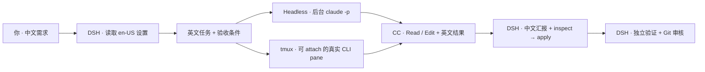
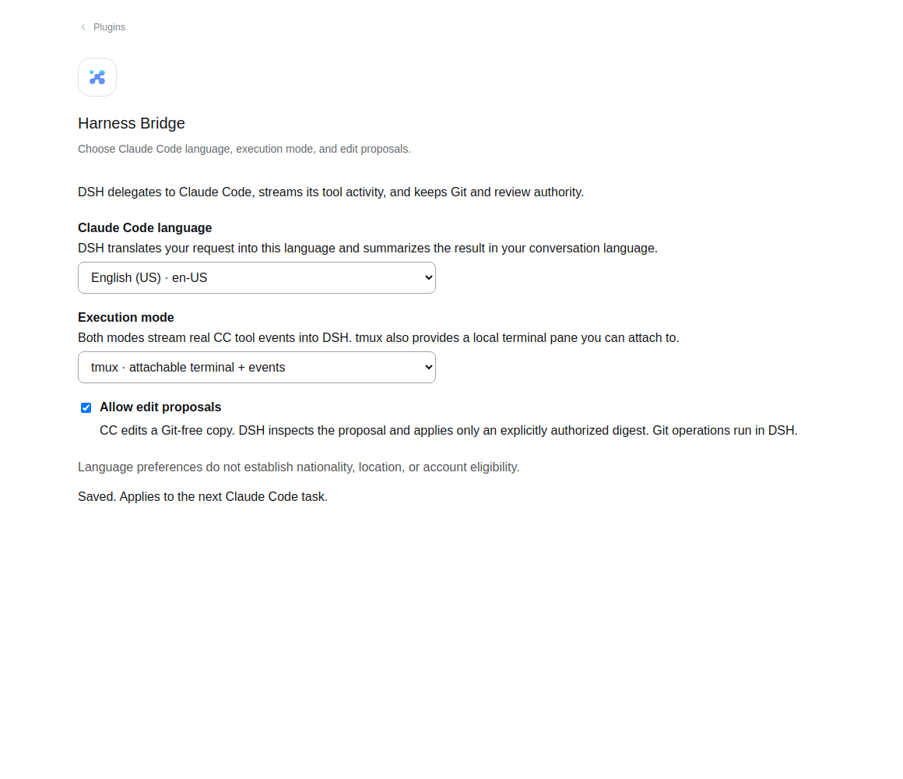
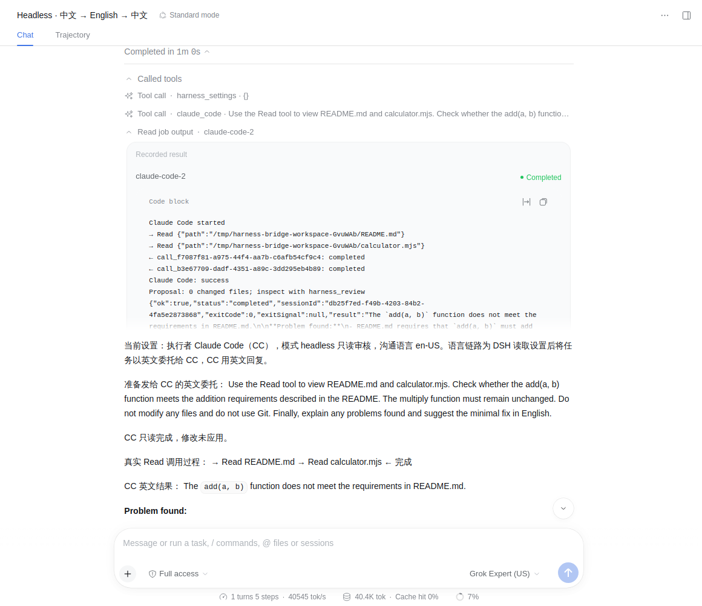
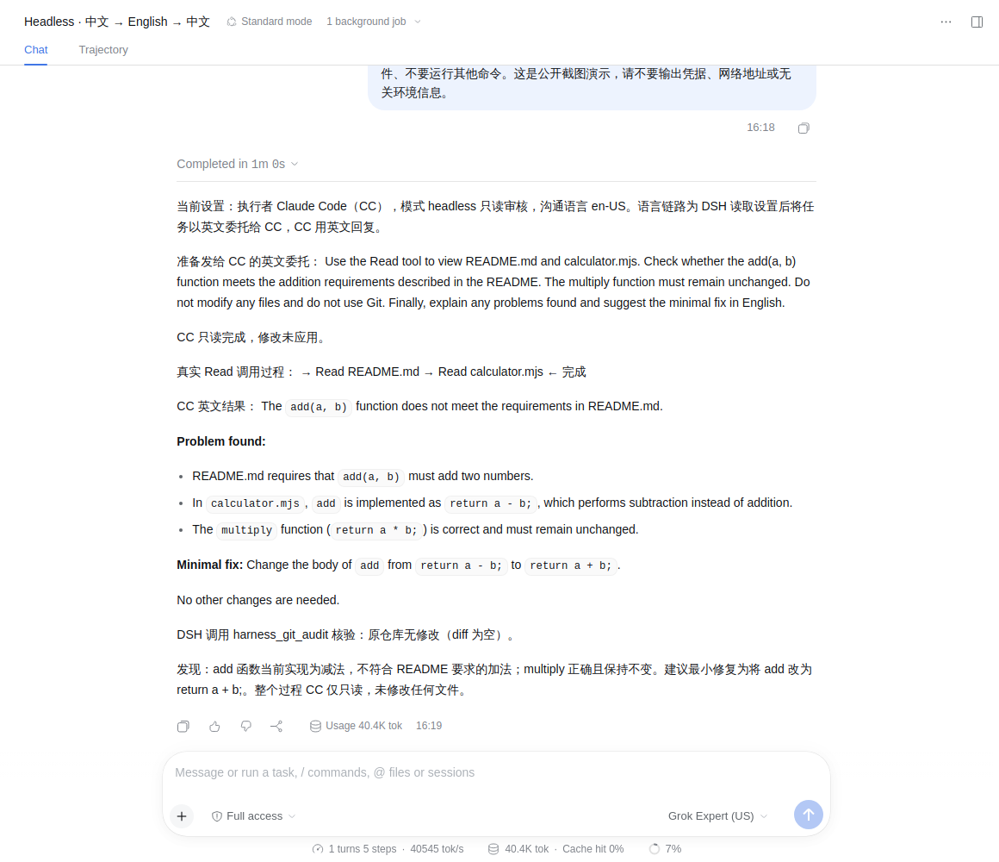
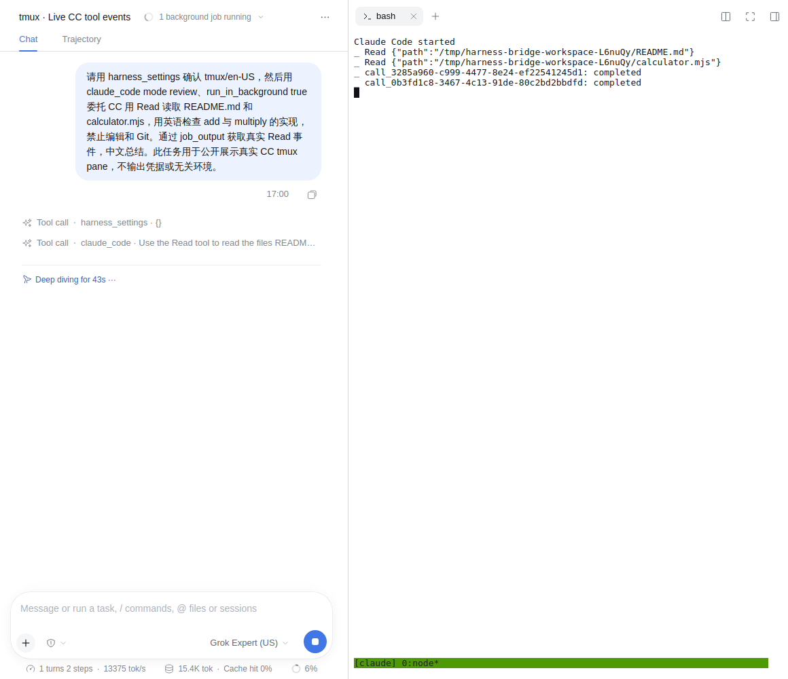
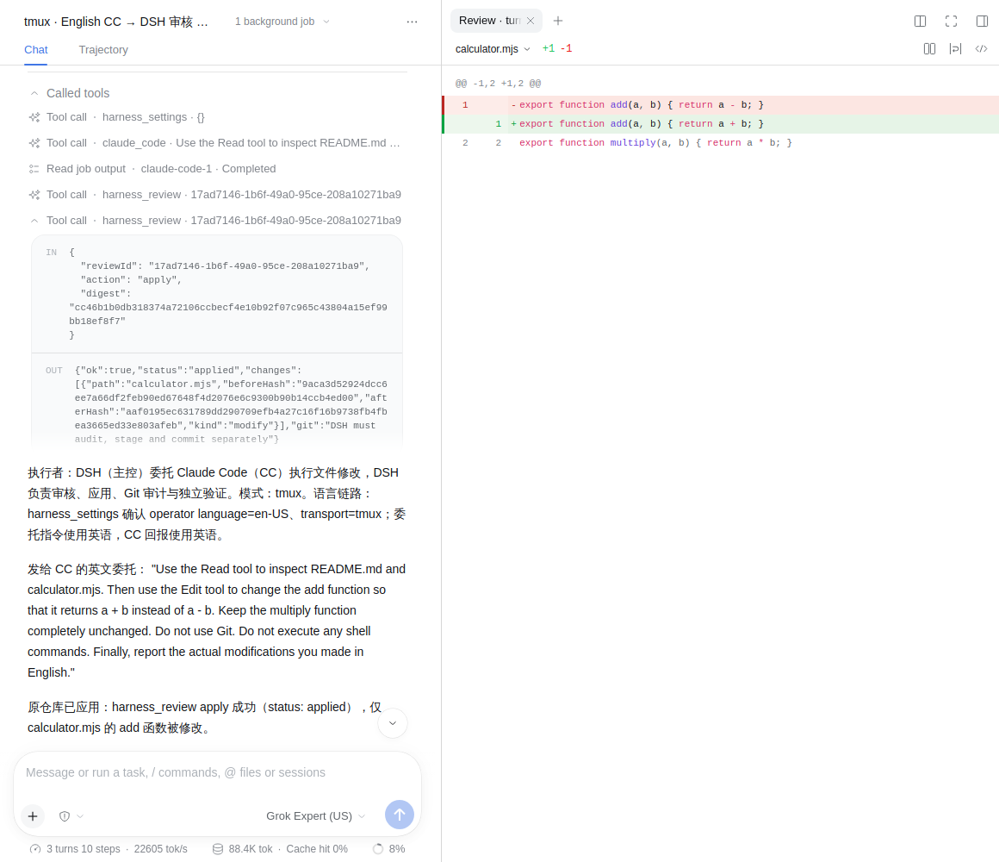

<div align="center">

[English](../README.md) · **简体中文**

# 🌉 Harness Bridge

### DSH 拆任务，看 Claude Code 执行，审核后再落盘。


[GitHub](https://github.com/WaeoTech/harness-bridge) · [安装](#安装与配置) · [设置](#语言与运行方式) · [Git 审核](#副本修改与-git-审核) · [实测记录](validation.md) · [Grok 配置](grok-compat.md)

</div>

Harness Bridge 把本机已有的 Claude Code CLI 接成 DSH 的工作工具。DSH 负责规划、权限和审核；CC 在不含 Git 元数据的临时副本里读写文件，真实工具事件进入 DSH 原生任务输出。

**0.2.0 为实验版本，源码公开，尚未发布 npm。** 已用真实 Claude Code `2.1.325`、Node `22.22.3`，在美国节点通过现有 Grok 反代验证 headless 读取、UUID 恢复、Git 文件拒绝、tmux 真实编辑和父进程审核应用，并在独立 DSH GUI 中完成语言设置、双模式任务和客户端独立断言。GUI 的 Add plugin 安装对话框、Anthropic 官方模型、macOS 和 Windows 仍未实测。详见[验证记录](validation.md)。

## 一眼看懂交互

**中文提需求 → DSH 用英语委托 → CC 真实 Read / Edit → DSH 中文汇报 → DSH 审核与 Git。** CC 的工作语言和你与 DSH 的对话语言可以不同。



| 方式 | CC 实际在哪里运行 | 你能看到什么 |
| --- | --- | --- |
| Headless | 插件管理的无终端后台进程 | DSH 原生 job 中真实的工具事件、CC 英文发现、DSH 中文总结 |
| tmux | 私有 tmux pane 内的同一个 CLI 协议 | 同样的原生 job 输出，还能在同主机、同用户的终端 attach 实际 CC 进程 |

下列截图来自真实、独立的 **US DSH Web 实例**，使用 Claude Code `2.1.325` 和操作者配置的 Grok 反代，不是生成的效果图。测试通过本地软链加载插件 bundle；尚未验证 GUI 的 Add plugin 安装对话框。

<details>
<summary><strong>1 · Plugins → Harness Bridge：选择语言、模式和编辑权限</strong></summary>

选择 `English (US) · en-US`，切换 headless / tmux，需要编辑时再开启提案权限。原生表单保存后显示确认，下次任务的 `harness_settings` 会读到实际配置。



</details>

<details open>
<summary><strong>2 · Headless：英文委托，真实 Read 过程，中文汇报</strong></summary>

中文请求要求 CC 只读检查算术模块。DSH 用英语下发任务，读取原生 job 的实际工具事件，展示 CC 的英文发现并用中文说明问题。原仓库 Git diff 保持为空。





</details>

<details open>
<summary><strong>3 · tmux：DSH 任务与真实 CC 终端 pane</strong></summary>

CLI 在插件管理的私有 tmux 会话中运行。在同主机、同 OS 用户的 DSH 终端执行 attach 命令，可以看到同一个真实 CC 进程。图中是对修复后模块的只读复核；实际编辑任务执行了 `Read → Read → Edit`。



</details>

<details>
<summary><strong>4 · DSH 审核：检查提案、精确摘要应用、读取真实 Git diff</strong></summary>

编辑任务只将副本中 `add` 的减法改为加法。DSH 检查提案，在明确授权下应用精确 digest，再读取原仓库真实 Git diff。CC 没有执行 Git。独立断言检查两项加法和保持不变的乘法。



</details>

语言转换由父模型按任务指令完成，配合 CC 的回复语言预设，没有单独的翻译服务。以真实工具返回为准：模型声称执行过命令，不能作为执行证据。[实测记录与边界](validation.md)。

## 安装与配置

准备 Node.js 22+、DSH `0.2.0-rc.2`、供 DSH 插件管理器使用的 pnpm，以及已安装并通过自己的方式认证的 Claude Code。tmux 模式另外需要 tmux。

```bash
git clone https://github.com/WaeoTech/harness-bridge.git
cd harness-bridge
node bin/cli.js doctor
dsh plugin --profile web add "$PWD"
```

通过 DSH 支持的配置编辑入口配置插入的 `tool-harness-bridge`。也可以在 Web profile 的 `~/.dsh/profiles/web/cordis.patch.yml` 增加完整覆盖，再通过 DSH 配置流程应用：

```yaml
- id: tool-harness-bridge
  config:
    workspaceRoot: /absolute/project
    executable: claude
    language: en-US
    transport: tmux
    allowEdits: false
    maxTurns: 8
    maxBudgetUsd: 2
    timeoutMs: 300000
```

必须设置绝对 `workspaceRoot`；一个插件实例对应一个原始目录，同时只运行一个 CC 任务。只修改磁盘 patch 不保证现有进程立即加载。

在 `danger-full-access` 权限的 DSH 会话中发任务：

> 先读取 harness_settings，按配置的语言给 CC 下发认证模块审查任务。后台运行并读取 job_output，跟踪真实工具调用；结束后由你验证问题。遇到认证或权限失败停止。

需要修改文件时，在操作者设置中开启 `allowEdits`，再让 DSH 传 `mode: "edit"`。CC 的编辑会保留为提案，原目录不会立即改变。

卸载：

```bash
dsh plugin --profile web remove @waeotech/harness-bridge
```

## 语言与运行方式

在 DSH Web 打开 **Plugins → Harness Bridge**，直接选择 CC 沟通语言、运行方式和编辑提案权限。表单通过 DSH 原生配置服务保存，并显示主机是否接受更新。工作目录、可执行文件和执行限制在主机的 `tool-harness-bridge` 配置中设置。新设置作用于下一个任务，运行中的任务保留启动时快照。

| 设置 | 行为 |
| --- | --- |
| `language` | `zh-CN` 简体中文（默认）、`en-US` 美式英语、`en-GB` 英式英语、`ja-JP` 日语 |
| `transport` | `headless` 无终端后台进程（默认）或 `tmux` 插件托管会话 |
| `workspaceRoot` | 原始项目的绝对路径 |
| `allowEdits` | 默认关闭；开启后允许编辑提案与审核应用 |
| `executable` | 已安装的 `claude`，或操作者配置的反代启动脚本 |
| `maxTurns` | 默认 8，范围 1–100 |
| `maxBudgetUsd` | 默认 2，上限 100；费用仍为估算 |
| `timeoutMs` | 默认五分钟，最长一小时 |

父 DSH 先调用 `harness_settings`，再按返回的语言编写任务与验收条件。CC 的系统追加指令设置相应的回复语言和拼写习惯。插件没有额外调用翻译模型；语言预设不用于伪造国籍、所在地或账号资格，也不提供防封号保证。

## DSH 内看到什么

两种运行方式都消费 CC 真实 `stream-json` 事件，并创建 DSH 原生 job。输出示例：

```text
Claude Code started
→ Read {"path":"src/calculator.js"}
← toolu_...: completed
→ Edit {"path":"src/calculator.js"}
← toolu_...: completed
Claude Code: success
Proposal: 1 changed files; inspect with harness_review
```

展示的是实际工具名称、目标路径、完成或失败事件及最终状态；不展示隐藏推理，也不会把完整文件正文当作进度打印。任务是否正确仍由父 DSH 检查。

`claude_code` 的 `run_in_background: true` 会立即返回 `jobId`，随后通过 DSH 的 `job_output` 读输出、`job_kill` 取消。前台执行也创建同样的原生任务，然后等待完成。

选择 tmux 后，任务输出会出现当前会话的 attach 命令：

```bash
tmux -S '/tmp/harness-bridge-tmux-.../socket' attach -t claude
```

插件创建私有 tmux server，在 pane 内实际运行 `claude -p`，pane 显示同源的工具执行过程，原始结构化事件回传 DSH。完成或取消后清理会话和临时日志。attach 需要访问相同主机及 OS 用户的终端。当前不接管已经手动打开的交互式 CC TUI；执行协议使用官方 JSON 事件，没有模拟键盘输入。

## 副本修改与 Git 审核

**CC 修改副本，DSH 审核并应用文件，Git 由 DSH 执行。**

1. 插件复制普通文件和目录，排除 `.git`、`.claude`、`node_modules`、符号链接和特殊文件。
2. CC 默认只开放 Read、Glob、Grep；编辑模式加 Edit、Write。禁用 Bash、子 agent、MCP、slash commands 和普通用户/项目 settings 来源，加载插件自己的工具保护 hook。
3. `PreToolUse` 检查工作目录及路径，拒绝 Git/Claude 元数据访问、目录穿越、符号链接和未授权工具。
4. CC 结束后返回 `reviewId`、实际变更清单；成功且有改动时状态为 `awaiting_review`。
5. DSH 调用 `harness_review` 的 `inspect`，取得实际 diff 与 `digest`，检查范围、验收条件并取得应用授权。
6. DSH 用相同 `reviewId`、`action: "apply"` 和精确 `digest` 应用。插件重新校验完整原始快照与冻结提案，存在并发修改就拒绝；写入失败尝试回滚。目前只支持新增、修改，删除会明确失败。
7. DSH 调用 `harness_git_audit` 读取原仓库 status 和 HEAD diff，再用自己的工具执行测试、暂存、提交或推送。插件不会自动执行这些 Git 写操作，也不会自动把审核输出转发给 CC。

不需要的提案用 `action: "discard"` 清理。保留提案期间可用返回的 UUID 恢复 CC，要求同一父 agent、根目录、子目录、模式和语言。已应用或丢弃的会话不能恢复。最多保留八份副本；插件重启/卸载会清理实例内保留的副本，不提供持久化会话记录。

副本限制为 64 MiB、5,000 普通文件、10,000 总条目；diff 超过 4 MiB 时明确标注截断。

**这些检查不是操作系统沙箱。** CC 与 DSH 共享 OS 用户，CLI 及操作者指定的可执行文件仍属于信任边界。`danger-full-access` 不隔离文件或凭据；路径复查和 `O_NOFOLLOW` 不能完全消除恶意并发父目录重命名竞争。应用是带冲突检测和回滚的文件操作，不是原子事务。处理不可信可执行文件或项目时，需要另外提供 OS 级隔离。

## 工具与反代

| 工具 | 用途 |
| --- | --- |
| `harness_settings` | 读取当前语言、执行方式、编辑权限 |
| `claude_code` | 启动或恢复 CC，支持前台和后台 |
| `harness_review` | 检查、精确摘要应用、丢弃提案 |
| `harness_git_audit` | 在 DSH 读取原目录 Git 状态和 diff |

独立 `bin/cli.js run` 和导出的 core 保留为底层调试接口，不提供原生插件的副本、审核、设置表单、jobs 或 Git 文件保护。需要上述完整流程时使用 DSH 插件。调试的 `--events` 原始输出可能包含源码和任务内容。

现有 OpenAI/Grok 反代可通过操作者私有配置和启动脚本接入 `executable`。测试中的 Grok Web 路径会把原生工具输出退化成文本，需要显式开启严格 JSON 文本工具模式。兼容包装器在自己的进程里保留上游密钥，只把每次运行的 loopback token 交给 CC；仍需检查真实工具事件和文件结果。[配置与限制](grok-compat.md)。

## 开发与验证

```bash
npm test
npm run check
npm pack --dry-run
```

当前开发环境 44 项自动测试全部通过，无失败和跳过，包含真实 DSH schema 引用、原生工具注册、后台取消、审核应用、冲突与回滚、文件访问保护、真实 tmux 的事件转发和取消清理。缺少 DSH peer 时相关测试明确跳过；缺少 tmux 时 tmux 测试明确跳过。

美国节点真实模型验证已通过：Read 随机校验串、UUID 恢复、原仓库 Git 配置读取被拒绝、tmux 中实际 Read/Edit、应用前原目录不变，以及审核应用后独立算术断言。独立 DSH GUI 还完成了原生语言表单、双模式任务、真实客户端 shell 的三项断言。完整结果及未验证范围见[验证记录](validation.md)。后续包括 GUI 的 Add plugin 安装对话框验证、持久化会话、删除支持、更强隔离和更多模型/平台兼容测试。

[架构与方案比较](architecture.md) · [完整英文说明](../README.md) · [MIT 许可证](../LICENSE)

README 展示结构参考 [qybaihe/bla](https://github.com/qybaihe/bla)，实现独立编写，不复用其代码、品牌、成绩或宣传指标。
